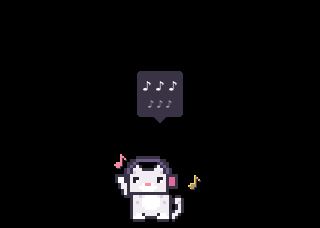
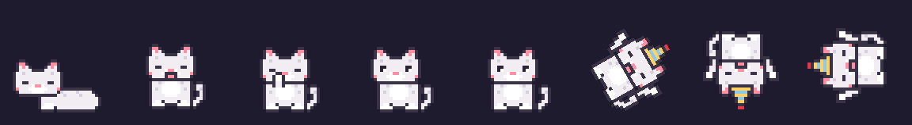
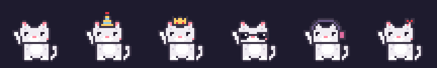
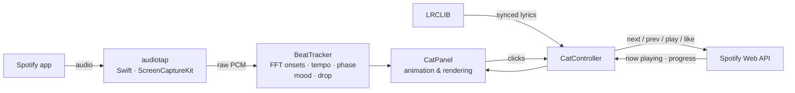

# 🐱🎵 Spotify Dancing Cat

A tiny pixel-art cat that lives on your desktop and **dances to whatever is playing on Spotify** — in real time, on the actual beat.
Click it to control playback, turn on synced lyrics, dress it up, and watch it fall asleep when the music stops.

<p align="center">
  
</p>

> Built with **Java 25 + JavaFX**, the **Spotify Web API**, **LRCLIB** for lyrics, and a tiny **Swift / ScreenCaptureKit** helper for live beat detection on macOS.

---

## ✨ Features

### 💃 Dancing
- **Real beat detection** – listens to Spotify's audio output (and only Spotify's), finds the tempo and the exact beat phase with an FFT-based onset detector, and keeps the cat locked to the groove.
- **Mood-aware choreography** – the cat reads the song's energy and switches between three moods:
  | Mood | What the cat does |
  |---|---|
  | **Chill** | slow sways with closed eyes, half-speed steps |
  | **Groove** | a mix of bops, side steps, spins and paw waves |
  | **Hype** | lots of flips, spins and higher jumps |
- **Drop detection** – when the bass drops, the cat does a huge jump + flip with a burst of stars.
- **Floating music notes** while dancing (more of them when the song is hyped).

### 😴 When nothing is playing
- The cat curls up and sleeps (with floating *Z*s).
- Every now and then it wakes up for a moment to **yawn, lick its paw, look around or wag its tail**.

<p align="center">
  
</p>

### 🎛️ Playback controls
- **Click the cat** to open a pixel-art control bar: ⏮ previous · ⏯ play/pause · ⏭ next · ❤ like · 🎤 lyrics.
- **Double-click the cat** to add the current song to your *Liked Songs* (it shows a little heart burst).
- The song title pops up in a bubble whenever the track changes.

### 🎤 Synced lyrics
- Time-synced lyrics from [LRCLIB](https://lrclib.net) appear in a speech bubble above (or below) the cat.
- Lines slide and cross-fade smoothly, with a dimmed preview of the next line.
- A drift-free playback clock keeps lyrics in sync, and you can fine-tune the timing (±0.1 s) from the menu – handy with Bluetooth headphones.

### 🎨 Style
- **Costumes:** party hat, crown, sunglasses, headphones and a bow.
- **Album-color theme:** buttons, bubbles and notes take on the dominant color of the current album cover and fade smoothly between songs.

<p align="center">
  
</p>

### 🪟 Desktop pet behavior
- Transparent, borderless, always-on-top window – just the cat, no frame.
- Drag it anywhere. Near the top of the screen the controls and lyrics automatically flip **below** the cat.
- Remembers its position, costume, lyrics setting and lyric timing.

---

## 📋 Requirements

| | |
|---|---|
| **OS** | macOS 14 or newer (live beat detection uses ScreenCaptureKit). Other platforms run with a fixed-tempo fallback. |
| **Java** | JDK 25 or newer (JavaFX is downloaded automatically by Gradle) |
| **Swift** | Xcode Command Line Tools (`xcode-select --install`) – used to build the small audio helper |
| **Spotify** | A **Spotify Premium** account (required by Spotify for playback control and for Development Mode apps) |

---

## 🚀 Getting started

### 1. Create a Spotify app
1. Go to the [Spotify Developer Dashboard](https://developer.spotify.com/dashboard) and click **Create app**.
2. Add this **Redirect URI** (Spotify requires `127.0.0.1`, not `localhost`):
   ```
   http://127.0.0.1:8888/callback
   ```
3. Select **Web API** and save. Copy your **Client ID**.

### 2. Configure
```bash
cp config.properties.example config.properties
```
Open `config.properties` and paste your Client ID:
```properties
spotify.clientId=YOUR_CLIENT_ID
```
`config.properties` and `tokens.json` are git-ignored, so your credentials never end up in the repo.

### 3. Run
```bash
./gradlew run
```
Or open the project in IntelliJ IDEA and run `com.dancingcat.Main`.

On first launch:
- Your browser opens the Spotify login page – click **Agree**. Tokens are stored locally in `tokens.json`.
- macOS asks for **Screen & System Audio Recording** permission (needed to hear Spotify's audio for beat detection). Allow it for the app you launched from (IntelliJ IDEA or Terminal), then restart the cat.
  You can also enable it later in *System Settings → Privacy & Security → Screen & System Audio Recording*.

Without the audio permission the cat still works – it just dances at a fixed tempo.

### 4. Install it as a Mac app (optional)
```bash
./gradlew installApp
```
This builds **Dancing Cat.app** (with its own Java runtime, so Java isn't needed to run it) and installs it to `~/Applications`.
Your `config.properties` and `tokens.json` are copied to `~/Library/Application Support/Dancing Cat`, which is where the app reads them from.
Drag the app to your Dock or Desktop and start the cat with a double-click.
The first time, macOS asks again for *Screen & System Audio Recording* permission – this time for "Dancing Cat".

---

## 🖱️ Controls

| Action | Result |
|---|---|
| **Click** the cat | Show / hide the control bar |
| **Double-click** the cat | Like the current song ❤ |
| **Drag** the cat | Move it anywhere on the screen |
| **Right-click** the cat | Menu: lyrics on/off, lyric timing, costume, current BPM & mood, quit |

---

## ⚙️ Configuration

All settings live in `config.properties`:

| Key | Default | Description |
|---|---|---|
| `spotify.clientId` | – | Your Spotify app's Client ID |
| `spotify.redirectUri` | `http://127.0.0.1:8888/callback` | Must match the Redirect URI in the Spotify dashboard |
| `dance.bpm` | `120` | Fallback tempo when live beat detection isn't available |
| `cat.scale` | `3` | Size of each pixel on screen (`2` = tiny, `5` = big) |

---

## 🧠 How it works



- **Beat tracking:** audio is split into 10 ms frames; a spectral-flux onset curve (with extra weight on the kick-drum range) is autocorrelated to find the tempo, then a comb filter finds where the beats fall. The cat's beat counter is nudged toward the estimate gradually and never runs backwards, so the dance never stutters.
- **Lyrics sync:** Spotify reports the playback position about once a second. A smoothed playback clock interpolates between reports, compensates for network latency and never jumps back, so lines don't flicker at boundaries.
- **Rendering:** each frame is drawn off-screen with Java2D (at 2× on Retina screens) and handed to a transparent JavaFX window in one go, only when something actually changes. An earlier Swing version occasionally showed an empty frame on macOS; JavaFX's GPU-backed window doesn't.
- **Sprites:** all pixel art (cat, costumes, icons, notes) is defined as small character grids in code – no image assets needed.

---

## 🗂️ Project structure

```
src/main/java/com/dancingcat/
├── Main.java                 # entry point
├── CatController.java        # glue between Spotify, lyrics, beat tracking and the UI
├── beat/                     # live beat tracking (FFT, tempo, phase, mood, drop) + audio capture
├── lyrics/                   # LRCLIB client and LRC parser
├── spotify/                  # PKCE auth, Web API client, playback clock, album colors
├── config/                   # config.properties loader
└── ui/                       # window, panel, sprites, choreography, idle behavior, costumes, themes
native/
├── AudioTap.swift            # captures Spotify's audio via ScreenCaptureKit, writes PCM to stdout
└── build.sh                  # builds the helper (called automatically by Gradle)
packaging/
├── DancingCat.icns           # app icon (made from the cat's own sprites)
└── MakeIcon.java             # regenerates the icon
```

---

## 🙏 Credits

- [Spotify Web API](https://developer.spotify.com/documentation/web-api) – playback state, controls and library
- [LRCLIB](https://lrclib.net) – free, open database of synced lyrics
- Pixel art, animations and beat tracking were made from scratch for this project.

This is a personal hobby project and is not affiliated with or endorsed by Spotify.
